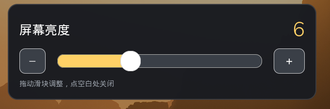
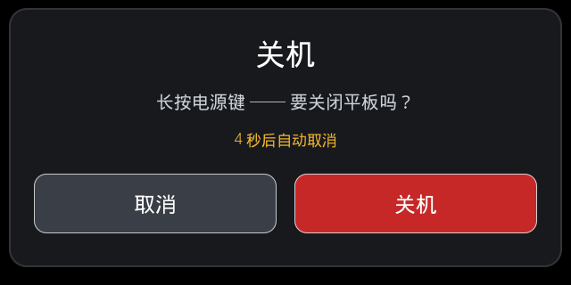

# cutiepi_tools

**Language:** English | [中文](README.zh-CN.md)

A small, self-contained toolkit for the **CutiePi CM4 tablet** running a stock
**Raspberry Pi OS** (no `cutiepi_shell`). It brings back the tablet behaviours the
official image had, using only stock system components:

* **automatic screen rotation** based on how you hold the tablet,
* **battery percentage + charging state in the system tray** (not a floating window),
* **a brightness tray icon** with a 1–15 slider,
* **power button handling** — short press = screen on/off, double press = shutdown
  confirmation dialog, 6-second hold = the MCU's power-off request, also confirmed
  by the dialog,
* **clean power-off** — on halt/poweroff the tablet really cuts battery power
  instead of being hard-cut by the microcontroller.

> **This project was built end-to-end by [DeepSeek Harness](https://www.deepseek.com/)
> driving the DeepSeek-V4.1-Flash 1017 model.** Protocol reverse engineering, on-device
> iteration, screenshots, tests and documentation were all produced in that
> agent session, talking to the real tablet over SSH.

<p align="center">
  
</p>

---

## Table of contents

- [What it does](#what-it-does)
- [Verified on](#verified-on)
- [Install](#install)
- [Quick reference (CLI)](#quick-reference-cli)
- [Configuration](#configuration)
- [The `config.txt` bits that matter](#the-configtxt-bits-that-matter)
- [How it works](#how-it-works)
- [Troubleshooting](#troubleshooting)
- [Repository layout](#repository-layout)
- [Known limitations](#known-limitations)
- [License](#license)

---

## What it does

| Feature | How it shows up | Implementation |
|---|---|---|
| **Auto-rotate** in all four orientations | Screen turns with the tablet | MPU6050 read from IIO sysfs → posture with hysteresis → `wlr-randr` (Wayland) or `xrandr` + touch matrix (X11) |
| **Battery + charging in the tray** | A number icon (`87`) in the panel, green while charging, tooltip `Battery 87% · Charging` | MCU serial protocol over `/dev/serial0` → StatusNotifierItem (SNI) tray icon drawn by us |
| **Brightness in the tray** | Sun icon, click → slider 1–15 | Second SNI item in its own process; writes `/sys/class/backlight/*/brightness` |
| **Screen on/off** | Short press of the power button | Writes `bl_power` |
| **Shutdown confirmation** | Full-screen dialog with *Cancel / Shut down* | Double press of the power button, or the MCU's 6-second request |
| **Real power-off** | Battery is physically disconnected at the end of a shutdown | `systemd` shutdown hook sends the MCU cutoff frame |
| **Diagnostics** | `cutiepi-hud diagnose` prints everything that matters | — |

<p align="center">
  <br>
  <em>Brightness popup — the sun icon grows with the level, the value is shown large for fingers.</em>
</p>

<p align="center">
  <br>
  <em>Shutdown confirmation — auto-cancels after 15 seconds, so a stray press is harmless.</em>
</p>

---

## Verified on

| Component | Value |
|---|---|
| Hardware | CutiePi CM4 tablet (Compute Module 4, 800×1280 DSI panel) |
| OS | Raspberry Pi OS 13 (trixie), 64-bit |
| Kernel | 6.18.x |
| Session | Wayland, `labwc` + `wf-panel-pi` |
| MCU | `Ver0.1`, battery/charge/button frames every 1.00 s on `/dev/serial0` |

Everything below was checked on that device: rotation in all four orientations,
battery reading while charging and discharging, brightness steps, screen toggle,
the confirmation dialog, and a full `poweroff` that ended with the battery
physically disconnected.

---

## Install

### Requirements

```bash
sudo apt install python3-gi gir1.2-glib-2.0 python3-cairo wlr-randr
```

`install.sh` installs these automatically (skip with `--no-deps`). PyGObject is what
lets the icons appear in the panel; `wlr-randr` is what rotates a Wayland output.

### Three steps

```bash
# 1. copy this repository to the tablet (any path, e.g. ~/cutiepi_tools)
# 2. install
cd ~/cutiepi_tools/cutiepi-hud
sudo ./install.sh

# 3. reboot (or log out and back in)
sudo reboot
```

The installer is idempotent and prints every change it makes:

* copies the program to `/opt/cutiepi-hud`
* installs `/usr/local/bin/cutiepi-hud`, `cutiepi-screen-on`, `cutiepi-screen-off`
* installs `/etc/cutiepi-hud.conf` (kept if it already exists)
* installs a **systemd user unit** and **enables** it (auto-start at login)
* installs udev rules so the `video` group may write the backlight and the
  `dialout` group may read the MCU serial port
* installs a `sudoers.d` rule so the power button may shut down without a password
* installs the shutdown hook that tells the MCU to cut power
* disables the serial getty on `ttyS0` (it steals the MCU frames)
* adds `avoid_warnings=2` to `config.txt` so the under-voltage popup stays quiet
* installs a logrotate rule for the daemon log

Uninstall:

```bash
sudo ./uninstall.sh            # keeps your config
sudo ./uninstall.sh --purge    # removes config and log as well
```

### Verify

```bash
cutiepi-hud diagnose        # hardware / session / MCU / tray report
cutiepi-hud tray-test       # animate a fake battery icon in the panel (no MCU needed)
cutiepi-hud test-rotate 90  # rotate once by hand, then `cutiepi-hud test-rotate 0`
cutiepi-hud monitor         # live accelerometer + posture, turn the tablet around
```

If rotation is correct but in the wrong direction for some orientation, run the
interactive calibration once (about 20 seconds):

```bash
cutiepi-hud calibrate          # which accelerometer axis means which posture
cutiepi-hud rotate-calibrate   # which rotation is upright for that posture
```

---

## Quick reference (CLI)

Everything is one binary, plus two tiny wrappers for scripting.

```bash
# ---- service ----
systemctl --user status cutiepi-hud
systemctl --user restart cutiepi-hud      # after editing the config
tail -f ~/cutiepi-hud.log                 # daemon log (only state changes are logged)

# ---- diagnostics ----
cutiepi-hud diagnose                      # full report
cutiepi-hud battery                       # one battery sample: 87% / 3.85 V / charging
cutiepi-hud monitor                       # live posture + raw accelerometer
cutiepi-hud tray-test                     # animate the tray icon (no MCU required)

# ---- rotation ----
cutiepi-hud test-rotate 90                # apply a rotation by hand
cutiepi-hud calibrate                     # calibrate axes -> posture
cutiepi-hud rotate-calibrate              # calibrate posture -> rotation angle
cutiepi-hud rotate-flip                   # flip all four orientations by 180°

# ---- screen ----
cutiepi-screen-off                        # backlight off
cutiepi-screen-on                         # backlight on
cutiepi-hud screen toggle                 # same, one command
cutiepi-hud screen status                 # prints on/off, exit code 0

# ---- brightness (1..15, native range of the panel) ----
cutiepi-hud brightness                    # prints e.g. 6/15
cutiepi-hud brightness 12                 # set
cutiepi-hud brightness +1                 # step up (-1 to step down)
cutiepi-hud brightness popup              # show the slider

# ---- power ----
cutiepi-hud power-dialog                  # preview the shutdown dialog
```

All of these are safe to call from your own programs: `screen` and `brightness`
return exit code `0` on success and `2` when the backlight device is not writable.

---

## Configuration

Defaults live in `/etc/cutiepi-hud.conf`; a user override can be placed in
`~/.config/cutiepi-hud/config.ini` (same `[section] key = value` format, takes
precedence). After editing, run `systemctl --user restart cutiepi-hud`.

The most interesting keys:

| Key | Default | Meaning |
|---|---|---|
| `display/swap_lr` | `false` | Swap 90°/270° if your panel is mounted the other way |
| `orientation/deg_normal` … `deg_right_up` | `180 / 270 / 0 / 90` | Rotation applied per posture (measured on the reference device) |
| `mcu/screen_toggle` | `true` | Short press of the power button toggles the backlight |
| `mcu/short_press_action` | `toggle` | `toggle` = screen, `dialog` = shutdown dialog, `none` |
| `mcu/double_press_dialog` | `true` | Double press opens the shutdown dialog |
| `mcu/double_press_ms` | `700` | Double-press window |
| `mcu/shutdown_dialog` | `true` | Ask before powering off |
| `mcu/shutdown_dialog_timeout` | `15` | Seconds before the dialog auto-cancels |
| `hud/icon_style` | `number` | `number` (digits drawn in the icon) or `battery` |
| `hud/icon_color` | `auto` | Follow the GTK theme; force with `light` / `dark` |
| `hud/brightness_icon` | `true` | Show the brightness (sun) tray icon |

Non-default values used on the reference tablet are documented in
`cutiepi-hud/src/cutiepi-hud.conf`.

---

## The `config.txt` bits that matter

A full, working `/boot/firmware/config.txt` is provided at
[`configs/config.txt`](configs/config.txt). Only a few lines are relevant here:

```ini
[all]
dtparam=i2c_arm=on                        # panel + IMU I2C
dtoverlay=cutiepi-panel                   # the DSI panel
dtoverlay=i2c5,pins_10_11                 # second I2C bus on GPIO10/11
dtoverlay=mpu6050-i2c5,interrupt=27       # accelerometer used for rotation
enable_uart=1                             # UART for the MCU
dtoverlay=uart1                           # exposes it as /dev/serial0
avoid_warnings=2                          # no under-voltage popup when unplugging
```

Notes:

* **`enable_uart=1` + `dtoverlay=uart1`** give `/dev/serial0` at 115200 baud, which is
  where the MCU reports battery, charging state and button presses.
* **`mpu6050-i2c5`** is what makes the accelerometer appear as an IIO device; without
  it `cutiepi-hud monitor` reports "no accelerometer".
* **`avoid_warnings=2`** only stops the *popup*; the panel's own under-voltage bolt
  comes from the firmware flags and disappears after a reboot. If the bolt keeps
  coming back while running on battery, the battery/boost path is sagging for real.
* The serial getty on `ttyS0` must stay disabled (the installer does it): it reads
  the MCU frames and throws them away.

---

## How it works

```
systemd --user: cutiepi-hud run
├── thread  mcu        : /dev/serial0  → battery, charging, buttons (+ ACKs)
├── thread  orientation: IIO accel     → posture     → wlr-randr / xrandr
├── thread  tray       : SNI item      → battery icon (digits drawn by us)
├── proc    brightness_tray : second SNI item (own D-Bus connection) → sun icon
│     └── proc  brightness_popup : GTK slider, writes brightness
└── proc    hud-overlay (optional) : fallback indicator if the panel has no tray
```

A few details that took the longest to get right, all documented in
[`docs/protocol.md`](docs/protocol.md):

* the MCU frame format and its 1-second cadence,
* the voltage-to-percentage curve (identical to the official shell),
* posture → rotation mapping and why it needs calibration on some units,
* the SNI properties a panel actually honours (`IconPixmap` as network-byte-order ARGB),
* why each tray icon needs its own process.

---

## Troubleshooting

| Symptom | Fix |
|---|---|
| No battery icon in the panel | `cutiepi-hud diagnose`; the panel must implement `org.kde.StatusNotifierWatcher`. `cutiepi-hud tray-test` isolates the icon from the MCU. |
| Battery says `--%` | The serial port is not readable: check `ls -l /dev/serial0` (must be `dialout`), and that `serial-getty@ttyS0` is masked. |
| Screen does not rotate | `cutiepi-hud test-rotate 90` first; if that works, the problem is the accelerometer (`cutiepi-hud monitor`). |
| Rotation direction wrong | `cutiepi-hud rotate-flip`, or run `calibrate` + `rotate-calibrate`. |
| Brightness does nothing | `cutiepi-hud brightness 10`; if it fails, the `video` group cannot write `/sys/class/backlight/*/brightness`. |
| Shutdown dialog never appears | `tail -f ~/cutiepi-hud.log` — the log records the button event value and the dialog exit code. |
| The tablet still powers off by itself | Holding the power button for 10 seconds makes the MCU cut power in hardware; that is not software-controllable. |

Logs: `~/cutiepi-hud.log` (state changes only), rotated weekly by
`/etc/logrotate.d/cutiepi-hud`. `: > ~/cutiepi-hud.log` clears it.

---

## Repository layout

```
.
├── README.md                    ← this file
├── README.zh-CN.md              ← Chinese version
├── CHANGELOG.md
├── LICENSE                      ← MIT
├── configs/
│   └── config.txt               ← complete Raspberry Pi config.txt from the tablet
├── docs/
│   ├── protocol.md              ← MCU protocol, battery curve, posture tables, SNI notes
│   └── screenshots/             ← partial screenshots used above
└── cutiepi-hud/                 ← the installable tool
    ├── install.sh / uninstall.sh
    ├── src/
    │   ├── cutiepi-hud          ← launcher
    │   ├── cutiepi-screen-on/off
    │   ├── cutiepi-hud.conf     ← fully commented default config
    │   └── cutiepi_hud/         ← Python modules
    ├── systemd/  udev/  sudoers/  autostart/  shutdown-hook/
    └── tests/                   ← 275 pure-logic checks, runnable on any machine
```

Run the tests without a tablet:

```bash
cd cutiepi-hud
python3 tests/run_tests.py
```

---

## Known limitations

* **UI strings and console messages are in Chinese.** Documentation is in English.
  Translating the on-screen dialog/popup text is a small, isolated change if needed.
* **The MCU only reports the power button at 6 seconds.** There is no earlier signal
  (the button is wired to the microcontroller, not to a Pi GPIO), so a shorter
  "hold to shut down" cannot be implemented in software. Double press is the fast path.
* **Holding the button for 10 seconds hard-cuts power.** That is the MCU's own
  behaviour and cannot be intercepted.
* The rotation angles in the default config were measured on one CutiePi CM4;
  panels mounted differently may need `rotate-flip` or `rotate-calibrate`.
* X11 support (`xrandr` + `xinput` touch matrix) is implemented but was only
  exercised on the X11 fallback, not on a full session.

---

## License

MIT — see [LICENSE](LICENSE).
