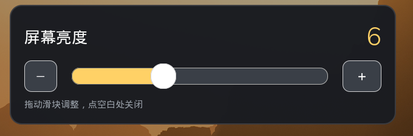
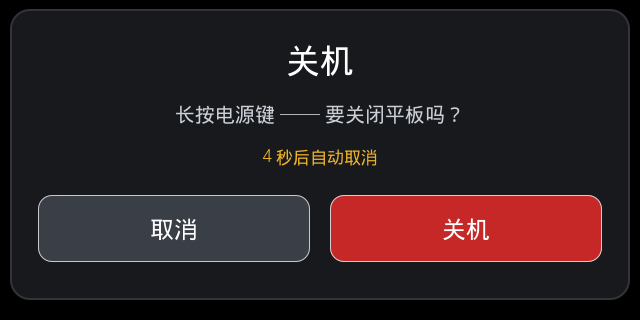

# cutiepi_tools

**语言：** 中文 | [English](README.md)

给 **CutiePi CM4 平板**用的一套小工具，面向"刷了官方 Raspberry Pi OS、不再使用
`cutiepi_shell`"的场景。它把原厂镜像里那些平板该有的能力，用系统自带组件重新做出来：

* 按摆放方向**自动旋转屏幕**；
* **在系统状态栏里**显示电量和充电状态（不是独立窗口）；
* 状态栏上的**亮度图标**，点开是 1–15 的滑块；
* **电源键处理**——短按开关屏幕、连按两下弹关机确认框、按住 6 秒响应 MCU 的关机请求
  （同样弹确认框）；
* **干净断电**——`halt`/`poweroff` 结束时让平板真正切断电池，而不是被单片机硬切。

> **本项目由 [DeepSeek Harness](https://www.deepseek.com/) 驱动 DeepSeek-V4.1-Flash 1017
> 模型端到端完成。** 协议逆向、真机联调、截图、测试和文档都在同一次 agent 会话里产出，
> 期间通过 SSH 操作真实平板。

<p align="center">
  
</p>

---

## 目录

- [功能一览](#功能一览)
- [真机验证环境](#真机验证环境)
- [安装](#安装)
- [快捷命令](#快捷命令)
- [配置](#配置)
- [config.txt 要点](#configtxt-要点)
- [工作原理](#工作原理)
- [故障排查](#故障排查)
- [仓库结构](#仓库结构)
- [已知限制](#已知限制)
- [许可证](#许可证)

---

## 功能一览

| 功能 | 表现 | 实现方式 |
|---|---|---|
| **四方向自动旋转** | 屏幕跟着平板转 | 从 IIO sysfs 读 MPU6050 → 姿态判定（带迟滞）→ `wlr-randr`（Wayland）或 `xrandr` + 触摸矩阵（X11） |
| **状态栏电量与充电** | 面板里一个数字图标（`87`），充电时变绿，悬停显示 `电池 87% · 充电中` | MCU 串口协议（`/dev/serial0`）→ 自己绘制的 StatusNotifierItem（SNI）托盘图标 |
| **状态栏亮度** | 太阳图标，点击弹出 1–15 滑块 | 独立进程里的第二个 SNI 图标；直接写 `/sys/class/backlight/*/brightness` |
| **息屏 / 亮屏** | 短按电源键 | 写 `bl_power` |
| **关机确认** | 全屏对话框，含「取消 / 关机」 | 连按两下电源键，或响应 MCU 的 6 秒请求 |
| **真正断电** | 关机结束时电池被物理断开 | `systemd` 关机钩子给 MCU 发送断电帧 |
| **诊断** | `cutiepi-hud diagnose` 打印所有关键信息 | — |

<p align="center">
  <br>
  <em>亮度弹窗——太阳随档位变大，数字放大便于手指操作。</em>
</p>

<p align="center">
  <br>
  <em>关机确认框——15 秒不操作自动取消，误触不会关机。</em>
</p>

---

## 真机验证环境

| 项目 | 值 |
|---|---|
| 硬件 | CutiePi CM4 平板（Compute Module 4，800×1280 DSI 屏） |
| 系统 | Raspberry Pi OS 13（trixie），64 位 |
| 内核 | 6.18.x |
| 会话 | Wayland，`labwc` + `wf-panel-pi` |
| MCU | `Ver0.1`，电量/充电/按键帧在 `/dev/serial0` 上每 1.00 秒一次 |

下列内容全部在该设备上实测：四个方向旋转、充电与放电时的电量读数、亮度各档位、
息屏开关、确认对话框，以及一次完整 `poweroff`（最后确实切断了电池供电）。

---

## 安装

### 依赖

```bash
sudo apt install python3-gi gir1.2-glib-2.0 python3-cairo wlr-randr
```

`install.sh` 会自动安装（加 `--no-deps` 可跳过）。PyGObject 决定图标能否进面板，
`wlr-randr` 决定 Wayland 下能否转屏。

### 三步

```bash
# 1. 把本仓库拷到平板任意目录，例如 ~/cutiepi_tools
# 2. 安装
cd ~/cutiepi_tools/cutiepi-hud
sudo ./install.sh

# 3. 重启（或注销重新登录）
sudo reboot
```

安装脚本是幂等的，每一步改动都会打印出来：

* 程序装到 `/opt/cutiepi-hud`；
* 安装 `/usr/local/bin/cutiepi-hud`、`cutiepi-screen-on`、`cutiepi-screen-off`；
* 安装 `/etc/cutiepi-hud.conf`（已存在则保留）；
* 安装并**启用** systemd 用户单元（登录自启）；
* 安装 udev 规则：`video` 组可写背光、`dialout` 组可读 MCU 串口；
* 安装 `sudoers.d` 规则：电源键关机不需要密码；
* 安装关机钩子（通知 MCU 断电）；
* 停用 `ttyS0` 上的串口控制台（它会吃掉 MCU 的帧）；
* 给 `config.txt` 加 `avoid_warnings=2`（消掉欠压弹窗）；
* 安装日志轮转规则。

卸载：

```bash
sudo ./uninstall.sh            # 保留配置
sudo ./uninstall.sh --purge    # 连配置和日志一起删
```

### 验证

```bash
cutiepi-hud diagnose        # 硬件 / 会话 / MCU / 托盘 报告
cutiepi-hud tray-test       # 在面板里演示电池图标（不需要 MCU）
cutiepi-hud test-rotate 90  # 手动转一次，再 cutiepi-hud test-rotate 0 转回来
cutiepi-hud monitor         # 实时加速度与姿态，把平板转一圈看看
```

如果旋转能用但个别方向不对，跑一次交互校准（约 20 秒）：

```bash
cutiepi-hud calibrate          # 加速度计哪个轴对应哪个姿态
cutiepi-hud rotate-calibrate   # 该姿态下哪个旋转角度是正的
```

---

## 快捷命令

所有功能都在一个命令里，另有两个两行的 shell 包装脚本方便你从自己程序里调用。

```bash
# ---- 服务 ----
systemctl --user status cutiepi-hud
systemctl --user restart cutiepi-hud      # 改完配置后重启
tail -f ~/cutiepi-hud.log                 # 守护进程日志（只记状态变化）

# ---- 诊断 ----
cutiepi-hud diagnose                      # 完整报告
cutiepi-hud battery                       # 采一次电池：87% / 3.85 V / 充电中
cutiepi-hud monitor                       # 实时姿态 + 原始加速度
cutiepi-hud tray-test                     # 演示托盘图标（不需要 MCU）

# ---- 旋转 ----
cutiepi-hud test-rotate 90                # 手动下发一个旋转
cutiepi-hud calibrate                     # 标定"轴 -> 姿态"
cutiepi-hud rotate-calibrate              # 标定"姿态 -> 旋转角度"
cutiepi-hud rotate-flip                   # 四个方向整体翻 180°

# ---- 屏幕 ----
cutiepi-screen-off                        # 关屏
cutiepi-screen-on                         # 亮屏
cutiepi-hud screen toggle                 # 同上，一个命令搞定
cutiepi-hud screen status                 # 打印 on/off，退出码 0

# ---- 亮度（1..15，就是面板原生范围）----
cutiepi-hud brightness                    # 打印当前值，例如 6/15
cutiepi-hud brightness 12                 # 设为 12
cutiepi-hud brightness +1                 # 加一档（-1 减一档）
cutiepi-hud brightness popup              # 直接弹滑块

# ---- 电源 ----
cutiepi-hud power-dialog                  # 预览关机确认框
```

这些命令都可以在别的程序里安全调用：`screen` 和 `brightness` 成功返回 `0`，
背光设备不可写时返回 `2`。

---

## 配置

默认值在 `/etc/cutiepi-hud.conf`；用户覆盖放
`~/.config/cutiepi-hud/config.ini`（同样的 `[section] key = value` 写法，优先级更高）。
改完执行 `systemctl --user restart cutiepi-hud` 生效。

常用键：

| 键 | 默认 | 含义 |
|---|---|---|
| `display/swap_lr` | `false` | 面板装反时交换 90°/270° |
| `orientation/deg_normal` … `deg_right_up` | `180 / 270 / 0 / 90` | 各姿态对应的旋转角度（参考机实测值） |
| `mcu/screen_toggle` | `true` | 短按电源键开关背光 |
| `mcu/short_press_action` | `toggle` | `toggle` 息屏 / `dialog` 弹关机框 / `none` |
| `mcu/double_press_dialog` | `true` | 连按两下打开关机框 |
| `mcu/double_press_ms` | `700` | 双击判定窗口（毫秒） |
| `mcu/shutdown_dialog` | `true` | 关机前确认 |
| `mcu/shutdown_dialog_timeout` | `15` | 确认框多少秒后自动取消 |
| `hud/icon_style` | `number` | `number`（数字画进图标）或 `battery` |
| `hud/icon_color` | `auto` | 跟随 GTK 主题；可强制 `light` / `dark` |
| `hud/brightness_icon` | `true` | 是否显示亮度（太阳）图标 |

参考机上用到的非默认值都写在 `cutiepi-hud/src/cutiepi-hud.conf` 的注释里。

---

## config.txt 要点

完整的、可用的 `/boot/firmware/config.txt` 见
[`configs/config.txt`](configs/config.txt)。与本项目相关的就这几行：

```ini
[all]
dtparam=i2c_arm=on                        # 面板与 IMU 的 I2C
dtoverlay=cutiepi-panel                   # DSI 面板
dtoverlay=i2c5,pins_10_11                 # GPIO10/11 上的第二路 I2C
dtoverlay=mpu6050-i2c5,interrupt=27       # 用于旋转的加速度计
enable_uart=1                             # MCU 用的串口
dtoverlay=uart1                           # 暴露成 /dev/serial0
avoid_warnings=2                          # 拔线时不再弹欠压提示
```

说明：

* **`enable_uart=1` + `dtoverlay=uart1`** 提供 115200 的 `/dev/serial0`，
  MCU 就在这条口上报电量、充电状态和按键。
* **`mpu6050-i2c5`** 让加速度计出现为 IIO 设备；没有它 `cutiepi-hud monitor`
  会报"没有找到加速度计"。
* **`avoid_warnings=2`** 只关掉**弹窗**；面板上那个欠压闪电图标来自固件标志，
  重启后才会消失。如果没插线也经常出现，说明电池/升压确实压降偏大。
* `ttyS0` 上的串口控制台必须保持停用（安装脚本会处理）：它会读走 MCU 的帧并丢弃。

---

## 工作原理

```
systemd --user: cutiepi-hud run
├── 线程  mcu        : /dev/serial0  → 电量、充电、按键（并回 ACK）
├── 线程  orientation: IIO 加速度计  → 姿态      → wlr-randr / xrandr
├── 线程  tray       : SNI 图标      → 电池图标（数字由我们绘制）
├── 进程  brightness_tray : 第二个 SNI 图标（独立 D-Bus 连接）→ 太阳图标
│     └── 进程  brightness_popup : GTK 滑块，写入亮度
└── 进程  hud-overlay（可选）: 面板没有托盘时的备用角标
```

最花时间的几个细节都写在 [`docs/protocol.md`](docs/protocol.md)：

* MCU 帧格式与 1 秒节拍；
* 电压 → 百分比曲线（与官方 shell 一致）；
* 姿态 → 旋转角度的映射，以及为什么有些机器需要校准；
* 面板真正认的 SNI 属性（`IconPixmap` 是网络字节序 ARGB）；
* 为什么每个托盘图标要单独一个进程。

---

## 故障排查

| 现象 | 处理 |
|---|---|
| 面板里没有电池图标 | 先 `cutiepi-hud diagnose`；面板必须实现 `org.kde.StatusNotifierWatcher`。用 `cutiepi-hud tray-test` 排除 MCU 因素。 |
| 电量显示 `--%` | 串口读不到：看 `ls -l /dev/serial0`（应为 `dialout`），并确认 `serial-getty@ttyS0` 已被 mask。 |
| 屏幕不旋转 | 先 `cutiepi-hud test-rotate 90`；能转说明是加速度计问题，用 `cutiepi-hud monitor` 看。 |
| 方向不对 | `cutiepi-hud rotate-flip`，或跑 `calibrate` + `rotate-calibrate`。 |
| 亮度没反应 | `cutiepi-hud brightness 10`；失败说明 `video` 组不能写 `/sys/class/backlight/*/brightness`。 |
| 关机框不出现 | `tail -f ~/cutiepi-hud.log`，日志里会记录按键值和对话框退出码。 |
| 平板自己断电了 | 按住电源键 10 秒是 MCU 的硬件断电，软件拦不住。 |

日志：`~/cutiepi-hud.log`（只记状态变化），由 `/etc/logrotate.d/cutiepi-hud` 每周轮转；
`: > ~/cutiepi-hud.log` 可清空。

---

## 仓库结构

```
.
├── README.md                    ← 英文说明
├── README.zh-CN.md              ← 本文件
├── CHANGELOG.md
├── LICENSE                      ← MIT
├── configs/
│   └── config.txt               ← 平板上完整的 config.txt
├── docs/
│   ├── protocol.md              ← MCU 协议、电量曲线、姿态表、SNI 细节
│   └── screenshots/             ← 上面用到的局部截图
└── cutiepi-hud/                 ← 可安装的工具本体
    ├── install.sh / uninstall.sh
    ├── src/
    │   ├── cutiepi-hud          ← 启动器
    │   ├── cutiepi-screen-on/off
    │   ├── cutiepi-hud.conf     ← 带完整注释的默认配置
    │   └── cutiepi_hud/         ← Python 模块
    ├── systemd/  udev/  sudoers/  autostart/  shutdown-hook/
    └── tests/                   ← 275 项纯逻辑测试，任意机器可跑
```

不需要平板就能跑测试：

```bash
cd cutiepi-hud
python3 tests/run_tests.py
```

---

## 已知限制

* **界面文案与控制台消息是中文**；文档有中英双语。若需要英文界面，改动很小且独立。
* **MCU 只会在第 6 秒上报电源键**，更早没有信号（按键接在 MCU 上，不是 Pi 的 GPIO），
  所以"按住更短时间就弹框"在软件层做不到；连按两下是快路径。
* **按住 10 秒会硬断电**，这是 MCU 自己的行为，无法拦截。
* 默认旋转角度是在一台 CutiePi CM4 上实测的，面板装配方式不同时可能需要
  `rotate-flip` 或 `rotate-calibrate`。
* X11 路径（`xrandr` + `xinput` 触摸矩阵）已实现，但只在 X11 兜底场景验证过，
  没有完整 X11 会话实测。

---

## 许可证

MIT，见 [LICENSE](LICENSE)。
